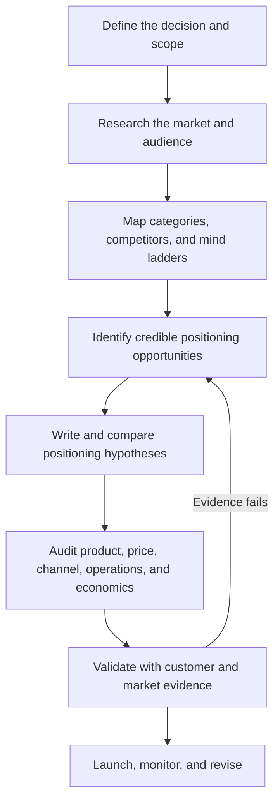

# Positioning Strategy Framework

A research-first, evidence-led Agent Skill for analyzing and designing market, product, brand, organization, and career positioning.

> Positioning is not a slogan generator. It is a disciplined process for choosing a valuable competitive frame, understanding the position already held in the audience's mind, proving a meaningful difference, and aligning the organization to deliver it.

## What this project provides

- A portable Agent Skill for Codex, Claude Code, OpenCode, and Pi.
- A 22-chapter conceptual map of Al Ries and Jack Trout's Chinese edition of *Positioning: The Battle for Your Mind*.
- Structured methods for category definition, competitor analysis, mind maps, positioning opportunities, positioning statements, strategic fit, and validation.
- Evidence and causal-attribution standards that distinguish a documented fact from a marketing claim and from a causal explanation.
- Reusable research templates, JSON schemas, examples, validation scripts, and diagrams.

## Start here

1. Read [the Chinese guide](README.zh.md) for the complete project overview.
2. Read the canonical [Agent Skill](skills/positioning-strategy/SKILL.md).
3. Use the [chapter map](skills/positioning-strategy/references/book-chapter-map.md) to connect the book's 22 chapters to operational methods.
4. Install the skill into supported agent directories:

```bash
python scripts/install_skill.py --agent all
```

Run validation:

```bash
python scripts/validate_repo.py
python -m unittest discover -s tests -v
```

## Core workflow



## Repository map

- `skills/positioning-strategy/`: canonical skill and reference knowledge.
- `templates/`: research brief, interview guide, competitor matrix, positioning statement, and audit templates.
- `schemas/`: machine-readable case and research schemas.
- `examples/`: explicitly synthetic worked examples.
- `scripts/`: installation, validation, scoring, and report-generation utilities.
- `assets/diagrams/`: reusable SVG diagrams.
- `.codex/`, `.claude/`, `.opencode/`, `.pi/`: agent-specific skill entry points.

## Research integrity

The framework requires source traceability, counter-evidence, explicit uncertainty, and a separate assessment of evidence quality and causal attribution. It does not infer that positioning caused growth merely because sales increased after a campaign. It also distinguishes the book's original propositions from this framework's modern operational extensions.

## Attribution and scope

The framework is an original operational synthesis inspired by the ideas and chapter structure of Al Ries and Jack Trout's *Positioning: The Battle for Your Mind*. It does not reproduce the book. See [references and reading notes](skills/positioning-strategy/references/book-chapter-map.md).

## License

No open-source license has been granted in this initial publication. Unless and until a license is added, all rights are reserved by the repository owner.
